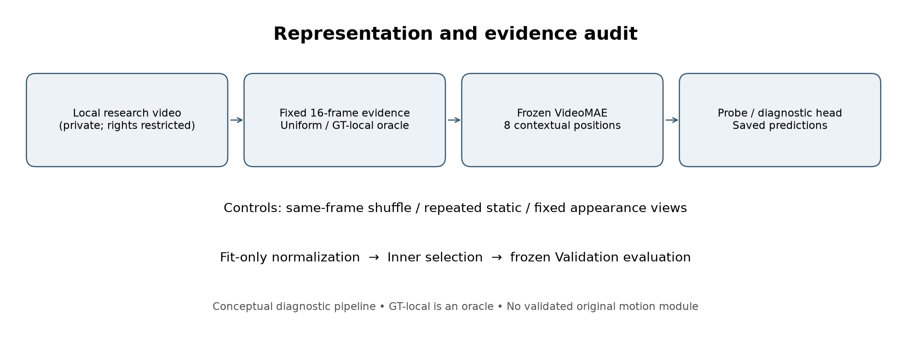
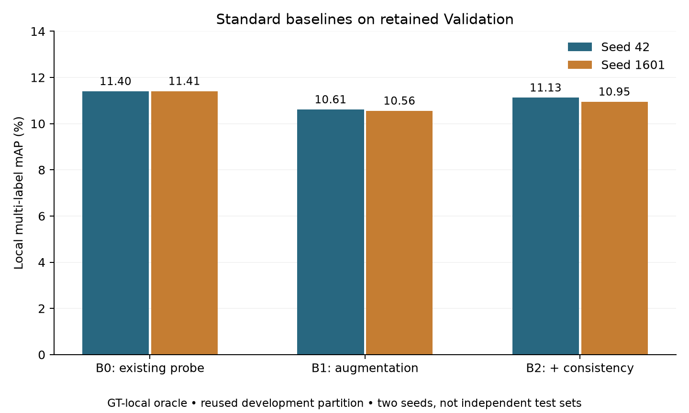
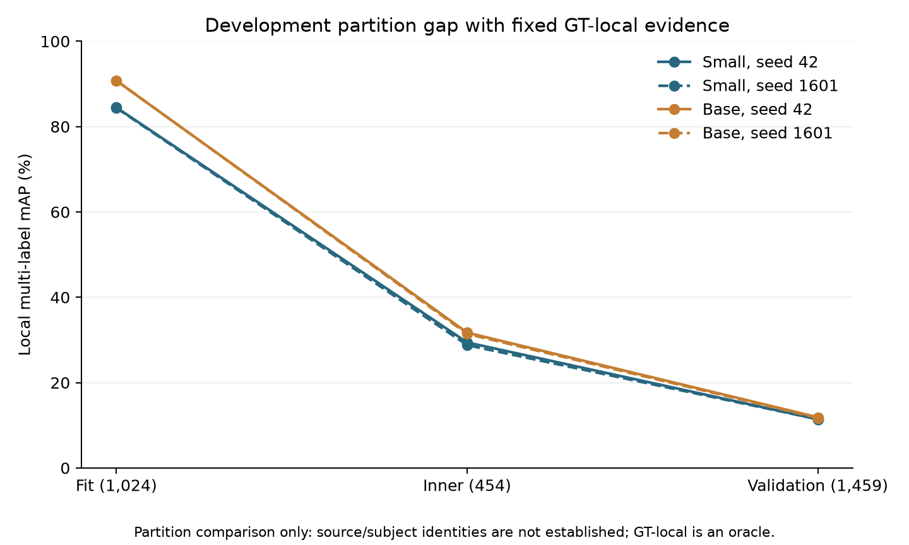

# Fine-Grained Motion Representation and Temporal Evidence Grounding

**Dongjun Miao · Independent research · Reproducibility and failure analysis**

This project investigates what video models observe, which motion evidence they miss, and why performance changes across development partitions. It documents a progression from hand-crafted motion descriptors to VideoMAE representations, temporal detection controls, and an explicitly rejected consistency-method candidate.

**Current conclusion:** no validated original motion-representation method or state-of-the-art claim. The principal contribution of this portfolio is a traceable experimental record, controlled negative results, and explicit limits on interpretation. Evidence grounding remains a research direction; no human-grounding benchmark was completed.



## Research questions and actual methods

- Does sparse temporal observation retain useful action evidence? Compare uniform, localized, shuffled and static inputs under documented frame budgets.
- Do local differences or stronger detection heads improve held-out development performance? Compare matched baselines, preserve failures, and audit overlap-aware evaluation.
- Does a stronger frozen encoder reduce the training–validation gap? Compare VideoMAE-S and VideoMAE-B using the same local diagnostic inputs.
- Does appearance consistency preserve action discrimination? Compare a frozen linear probe (B0), fixed appearance augmentation (B1), and prediction consistency (B2). A temporal-attribution candidate was stopped before natural-video training.

Actual historical methods include adjacent-frame differences/Farneback statistics, frozen RGB features, MLP/linear/temporal controls, prefix-grouped cross-validation, normalization × shuffle controls, frozen and last-block-adapted VideoMAE, and simple temporal detection heads. These are baselines and diagnostics, not claimed inventions.

## Selected verified results

The following local multi-label mAP values were **recomputed from saved private predictions during packaging**. They are percentages, not detection mAP or classification Macro-F1. Seeds are shown separately.

| Frozen VideoMAE-S local probe | Seed 42 | Seed 1601 |
|---|---:|---:|
| B0: clean existing probe | 11.40 | 11.41 |
| B1: standard fixed appearance augmentation | 10.61 | 10.56 |
| B2: augmentation + prediction consistency | 11.13 | 10.95 |

Protocol: 1,024 Fit / 454 Inner / 1,459 retained Validation videos; 16 GT-local frames; 52 local labels; identical linear head capacity; seeds 42/1601. B1/B2 use two views per update, B0 historically used one; this extra encoding/forward cost is not hidden. GT-local input is a **label-informed diagnostic oracle**, not a deployable localization result. Inner and Validation were repeatedly used in development.



B2 partly recovers the clean mAP lost by B1, but does not exceed B0. Greater prediction stability relative to B1 did not consistently improve target ranking. No M1 natural-video score exists. The static-appearance counterexample is a synthetic argument about an objective, not empirical evidence that every trained model collapses.



VideoMAE-B improved target MRR over Small in both seeds, while the large partition gap remained. Its small mean AP increase was not broadly supported across classes. The graph is a **partition comparison**, not proof of participant or camera-source shift.

## Completed studies and negative findings

- Stages 1–16: data checks, RGB/motion baselines, sampling, region controls and temporal-order experiments; historical artifacts retained. Earlier official-validation metrics and later prefix-OOF metrics are not interchangeable.
- WP1: normalization × shuffle controls completed; this did not establish motion-order reasoning.
- Local Delta: no stable five-fold gain; branch frozen rather than expanded.
- Full last-block adaptation: target fitting improved, with a substantial held-out development gap.
- MMA-52 detection and query-resolution studies: increasing query density or upgrading a small head did not resolve validation failure. A full mature ActionFormer system was not reproduced.
- Local evidence, stronger-encoder and appearance-consistency diagnostics: completed; only the selected local metrics marked VERIFIED were replayed for this release.
- Temporal-attribution candidate: rejected before natural-video training because of prior-art overlap and a static-solution counterexample. Future evidence learning is PROPOSED.

See [experiment inventory](docs/experiment_inventory.md), [evidence versus hypothesis](docs/evidence_vs_hypothesis.md), and [verification scope](docs/evidence/provenance.json).

## Generalization limitations

Filename prefixes are not verified Subject IDs. Domain-classifier discrimination supports detectable feature-distribution differences, not a causal source/identity explanation. No subject-independent performance is claimed locally. Shuffling changes tubelet pairing; repeated frames reduce pose diversity. Neither isolates natural weak-motion amplitude. Eight contextual temporal positions do not imply precise temporal boundaries. Development-set reuse, class imbalance, missing independent data and unresolved access permissions limit conclusions.

## Data access and reproduction

No videos, clips, individual labels/predictions, embeddings, weights, participant identifiers or third-party model source are bundled. Obtain data and models from their owners under applicable terms; consult [data and license audit](docs/data_and_license_audit.md). Official test placeholders are never evaluation ground truth.

Python 3.10+; CPU only for this package:

```bash
python -m venv .venv
# Activate .venv using your shell.
python -m pip install -r requirements.txt
python -m unittest discover -s tests -v
python scripts/validate_release.py
python scripts/make_figures.py
```

The tests use **synthetic inputs only**. Plot regeneration uses published aggregate research statistics, not synthetic performance numbers. An authorized user may evaluate local arrays using `python scripts/evaluate_local.py private_data/predictions.npz` with the schema in [reproducibility](docs/reproducibility.md). This public package supports metric checks and figure reproduction, **not a one-command rerun of every historical training run**. Historical launchers and dependencies are mapped there; inaccessible data are not replaced by fabricated results.

## Repository map

`src/fgmotion/`: portable metric/protocol utilities; `src/historical/`: selected unchanged first-party research utilities; `configs/`: local template and historical protocol; `tests/`: synthetic checks; `scripts/`: evaluation, figures, release validation; `docs/evidence/`: aggregate results and provenance; `figures/`: three dataset-free figures.

## References

- [MA-52 / Benchmarking Micro-action Recognition](https://github.com/VUT-HFUT/Micro-Action)
- [MMAD / MMA-52](https://github.com/kunli-cs/MMAD)
- [VideoMAE](https://github.com/MCG-NJU/VideoMAE)
- [OpenTAD](https://github.com/sming256/OpenTAD); [MAC 2024 challenge baseline](https://github.com/VUT-HFUT/MAC_2024_baseline)
- [CARL](https://openaccess.thecvf.com/content/CVPR2022/html/Chen_Frame-Wise_Action_Representations_for_Long_Videos_via_Sequence_Contrastive_Learning_CVPR_2022_paper.html); [Logit Attribution Matching, UAI 2024](https://proceedings.mlr.press/v244/gao24a.html)

These references are context and dependencies, not endorsements or claims of reproducing each method. See [research decisions](docs/research_decisions.md). Release prepared 2026-11-12; historical experiments principally October 2026. No paper acceptance, external affiliation endorsement or SOTA performance is claimed.
